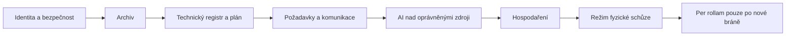

# Roadmapa a brány dokončení

Stav: **NÁVRH**. Všechny etapy jsou při předání neimplementované v auditovaném commitu. Existující kostra je výchozím stavem, nikoliv dokončením některé z bran.

## Pořadí dodávek

| Etapa / priorita | Obsah a backlog | Závislost | Brána výstupu |
|---|---|---|---|
| E0 / P0 | Baseline, izolované prostředí, klasifikace dat, přihlášení, role, RLS, audit, záloha; SEC-01–07 | Přístup k vývojovému Supabase, určený správce rolí | G0: negativní API testy, žádná anonymní práce s interními daty, obnova ověřena |
| E1 / P1 | Archiv a verze; DOC-01–04 | G0 | G1: dvě verze, souborová práva, hledání a znepřístupnění ověřeny |
| E2 / P1 | Import, registr, zjištění, plán oprav a revize; TEC-01–05 | G0; důkazy přes E1 | G2: 21 prvků, 4 rezervy v protokolu, správné chybějící hodnoty, pilotní doplnění ověření |
| E3 / P1 | Požadavky, konverzace, kontakty a návaznost záměrů; REQ-01–05 | G0, přílohy přes E1, vazby přes E2 | G3: cesta hlášení–vyřízení, odlišená soukromá komunikace, kontrolovaný převod starých dat |
| E4 / P2 | Citované AI odpovědi, příprava vytěžování; AI-01–04 | G1–G3, schválené zdroje a poskytovatel AI | G4: evaluační sada, nulové úniky, přiznané neznalosti, rozpočtový limit |
| E5 / P2 | Finanční importy, přehledy, zakázky; FIN-01–03 | G1–G3 a skutečné podklady správce | G5: kontrolní součty sedí, období úplnosti viditelné, duplicity nezkreslují výdaje |
| E6 / P3 | Fyzická schůze, program, účast, zápis, úkoly; MTG-01–03 | G1–G3; ověřené vlastnictví a pravidla | G6: zkušební schůze, podíly bez dvojího započtení, schválený zápis |
| E7 / P4 | Samostatná analýza a případná implementace per rollam; VOT-01 | Stabilní systém, právně ověřený proces a rozhodnutí výboru | G7: vlastní schválené zadání; do té doby modul vypnut |

Etapy nevyjadřují počet týdnů ani smluvní cenu. Odhad práce se připraví až po E0 a zvolení varianty identity, dokumentového zpracování a provozu. Kapacita i provozní náklady jsou nyní neznámé.

## Závislosti

Graf určuje preferované pořadí produktu. AI není technickou podmínkou finanční evidence a hospodaření není technickou podmínkou přípravy programu schůze. Pokud chybí podklady správce nebo poskytovatel AI, lze po rozhodnutí vlastníka produktu provést nezávislé části pozdější etapy; odchylka se zapíše, nevydává se za dokončení předchozí brány.

## Definice stavu práce

`Navrženo → Připraveno → Implementováno lokálně → Testově ověřeno → Nasazeno do testu → Pilotně ověřeno → Převzato`.

Každá karta uvádí vlastníka, commit, výsledky kontrol a prostředí. Slovo „hotovo“ se nepoužije pro stav, kdy existuje pouze UI nebo migrace v Gitu. Nesplněná akceptace vrací kartu do rozpracování. Pilot neprokazuje dlouhodobou provozní spolehlivost.

## První praktický sled

1. Založit vývojovou větev až při samostatném zadání implementace, aktualizovat audit, určit testovací Supabase a správce prvního účtu.
2. Realizovat E0 bez produkčních osobních dat. Zvlášť ověřit veřejné koncepty, veřejný INSERT a změnu role uživatelem.
3. Realizovat malý archiv s právy a verzemi. Nepřidávat AI jako podmínku vyhledávání.
4. Provést suchý import Excelu. Schválit 21 prvků a řešení čtyř rezerv. Vytvořit plán ověření neznámých stavů, nikoliv fiktivní opravy.
5. Doplnit požadavky a ověřit celý pilotní příběh. Teprve pak rozhodnout o rozsahu E4 a E5.
