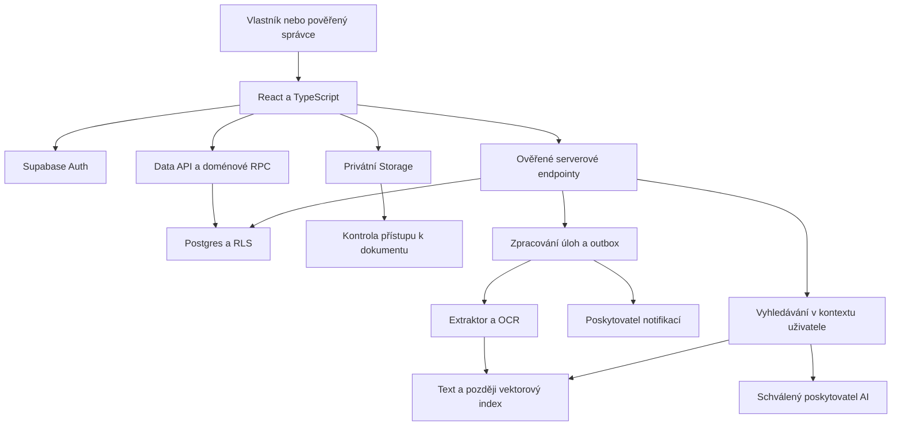

# Architektura a přechod ze současné aplikace

Stav: **NÁVRH**, s výjimkou označeného výchozího stavu K01–K10 v [auditu](00_STAV_A_ZDROJE.md).

## Výchozí stav

React SPA s Vite používá React Router a TanStack Query. Stránky přímo čtou a zapisují Supabase. Databázové schéma v Gitu tvoří pět tabulek; neobsahuje doménu identity SVJ, úložiště dokumentů ani serverové funkce. Zachovat stávající styl komponent a základní routy, změny rozdělit do malých ověřitelných dodávek.

## Cílové vrstvy

Zpracování dokumentů a AI jsou pozdější rozšíření. P1 musí fungovat bez LLM i bez externího OCR. Načítání metadat a titulů dokumentů podléhá stejným oprávněním jako obsah.

## Návrhové zásady

1. Jeden modulární frontend a jedna relační databáze. Pro tuto velikost projektu nezačínat mikroservisami.
2. Jedno SVJ v pilotu; `organization_id` ve všech doménových datech brání neúmyslnému sdílení a usnadňuje testy izolace. Nejde o závazek vyvíjet SaaS platformu.
3. UI skrývá nepovolené akce, databáze a backend je skutečně zakazují. Role nejsou autoritou v localStorage ani v uživatelem měnitelných metadatech.
4. Běžné čtení běží s identitou uživatele přes RLS. Vícekrokové změny stavu a propojených záznamů se provádějí v databázové transakci přes omezené RPC nebo ověřený backend.
5. Privilegovaný klient slouží jen pro nezbytné servisní úlohy. Z jeho použití nelze odvodit právo konkrétního uživatele; backend předem ověřuje rozsah a audit.
6. Stav, důkaz, jistota a datum jsou samostatná data. Neznámé hodnoty nesmějí zmizet při agregaci.
7. Všechny background úlohy mají idempotentní klíč, omezené opakování, stav chyby a možnost řízeného opakování.

Technické podklady: [RLS](https://supabase.com/docs/guides/database/postgres/row-level-security), [Storage](https://supabase.com/docs/guides/storage/security/access-control), [Edge Functions](https://supabase.com/docs/guides/functions/auth). Implementace ověří kompatibilitu projektu; tento dokument nepředepisuje neotestovanou syntaxi SDK.

## Navržené rozdělení kódu

| Umístění | Účel |
|---|---|
| `src/features/auth/` | Přihlášení, členství, aktuální kontext SVJ |
| `src/features/documents/` | Archiv, metadata, verze, autorizované stažení |
| `src/features/technical/` | Prvky, hodnocení, plán ověření, opravy a revize |
| `src/features/requests/` | Požadavky, komunikace a kontakty |
| `src/features/finance/`, `meetings/`, `ai/` | Pozdější moduly podle roadmapy |
| `src/components/ui/` | Sdílené základní komponenty, zachovat existující knihovnu |
| `src/lib/` | Formátování a čisté doménové funkce; bez serverových klíčů |
| `supabase/migrations/` | Verzionované inkrementální migrace včetně politik |
| `supabase/functions/` | Ověřené endpointy pro procesy vyžadující backend |
| `supabase/tests/` a integrační testy | Oprávnění, invarianty a transakce |

Jde o cílové cesty. V auditovaném stromu tyto feature adresáře neexistují. Není cílem předem přesouvat celou kostru bez funkční potřeby.

## Přechod dat a zachování funkcí

| Stávající entita | Návrh přechodu |
|---|---|
| `news` | Zachovat ID a URL, přidat SVJ, klasifikaci, autora účtu a DB pravidla publikace. Výchozí nově vytvořený obsah je interní koncept. |
| `intents` | Zachovat ID i původní hodnoty, doplnit vazbu na SVJ a případný požadavek/opravnou akci. Návrh vlastníka není schválená investice. |
| `forms` | Zachovat definice pro zpětnou dohledatelnost. Nové formuláře mají typ a verzi schématu a serverovou validaci. |
| `form_submissions` | Nezměnit původní JSON. Neznámému autorovi nepřidělit účet podle jména. Po ruční klasifikaci vytvořit požadavek s unikátním `legacy_submission_id`; survey zůstává průzkumem. |
| `settings` | Oddělit výslovně veřejné nastavení od interní konfigurace a secretů. Stávající klíče inventarizovat, nezveřejnit celou tabulku. |

Původní migraci nepřepisovat. Při implementaci porovnat Gitem popsané schéma s testovacím a následně skutečným prostředím. Zálohovat, evidovat počty a kontrolní součty, doplnit nullable sloupce, provést doložený backfill a až poté omezit nullability a přepnout UI. Široké politiky je nutno výslovně odstranit: přidání další restriktivně vypadající permisivní politiky nepřebije `USING (true)`.

Pro historická data bez původu nastavit viditelné `legacy_unverified`; nesmí se automaticky publikovat do vlastnického archivu. Konkrétní postup omezení současných veřejných funkcí se plánuje s vlastníkem produktu v E0, aby bezpečnostní oprava nevyvolala tichou ztrátu podání.

## Dokumentový tok a konzistence

1. Oprávněný uživatel založí upload intent s klasifikací a limity souboru.
2. Soubor se uloží do privátní karantény pod neuhodnutelným klíčem; nedůvěřovat názvu ani MIME z prohlížeče.
3. Po kontrole typu, velikosti a dostupném bezpečnostním skenu se verze finalizuje. Do schválení je dostupná jen správci uploadu podle ACL.
4. Verze získá checksum, velikost, skutečný typ, autora a čas. `ready` nesmí ukazovat na neexistující objekt. Neúspěšný upload zůstává opakovatelný nebo se bezpečně uklidí.
5. Extrakce/OCR může selhat nezávisle na archivaci. Archiv je funkční i se stavem „text nezpracován“.
6. Publikace pro konkrétní skupinu vyžaduje oprávnění a audit. Nová verze nepřepisuje staré bajty.

Storage a databáze nemají jednu společnou transakci; kompenzace se proto řeší stavy a úklidem opuštěných objektů, ne příslibem atomického uploadu. Stejně tak odeslání e-mailu probíhá z transakčního outboxu až po commitnutí požadavku.

## Provozní návrh

Vývoj, test a produkce mají oddělené Supabase projekty nebo jinak prokázanou izolaci. Frontend `.env.local` obsahuje jen veřejné konfigurační proměnné; serverové a AI klíče jsou ve správě secrets. CI provádí build, lint, typovou kontrolu a přiměřené integrační testy. Zvolený package manager musí mít jeden autoritativní lockfile.

Pro pilot navrhujeme dosažitelnost bez ztráty potvrzených dat, monitoring chyb a velikosti úložiště, nákladové limity a denní kontrolu selhaných úloh. Konkrétní zálohovací plán, RPO/RTO, retenční doby a poskytovatele schválí provozní vlastník před skutečnými daty; dostupné funkce tarifu nebyly ověřeny.
