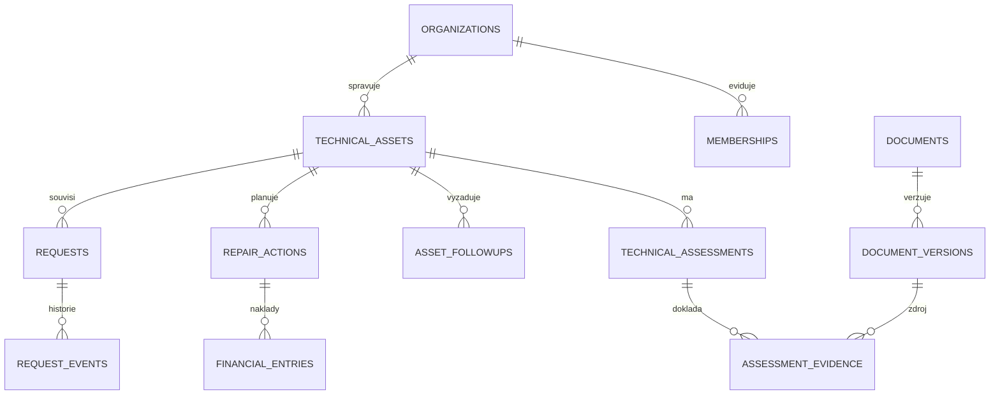

# Cílový datový model

Stav: **NÁVRH KONTRAKTU**, nikoliv hotové SQL. Současných pět tabulek popisuje [audit K06](00_STAV_A_ZDROJE.md). Model zavádět po etapách; pozdější tabulky se v E0 nevytvářejí pro jistotu.

## Společné konvence

PK je `uuid`; stávající UUID se zachovávají. Každá doménová tabulka má `organization_id`, `created_at`, `created_by` a podle potřeby `updated_at`, `updated_by`, `row_version`. Časy jsou `timestamptz` v UTC, uživatelské zobrazení Europe/Prague; čisté termíny jsou `date`, plánované roky `integer`. Náklady jsou `numeric(14,2)`, měna explicitně `CZK`, ne float. `NULL` znamená chybějící hodnotu, ne nulu. Texty se uchovávají v původním znění vedle normalizovaných kódů.

FK nesmí propojit různá SVJ: použít složené reference `(organization_id, id)` s příslušnými UNIQUE klíči nebo ekvivalentně prokazatelné serverové omezení. Sloupce pro členství, tenant ID, audit a schválení nejsou volně měnitelné vlastníkem z UI. Indexovat FK a sloupce používané v RLS; velké JSON pole nenahrazuje základní relační vazby.

## Identita, dům a oprávnění – E0

| Tabulka | Základní pole a invariant |
|---|---|
| `organizations` | id, název SVJ, kontaktní údaje, timezone; vytvoření pouze správou prostředí |
| `buildings`, `entrances` | organization_id, budova, vchod, označení; umístění z Excelu může do ověření zůstat prostý text |
| `units` | budova/vchod, označení, podíl numerator/denominator; podíly a jednotky naplnit až z ověřeného zdroje |
| `profiles` | user_id FK na auth.users, zobrazované jméno; bez autoritativního role stringu měnitelného uživatelem |
| `memberships` | organization_id, user_id, status invited/active/suspended/ended, platnost; UNIQUE organizace + uživatel |
| `membership_roles` | membership_id, role owner/board/manager/technical/system_admin, platnost; serverově přidělované |
| `scoped_grants` | membership_id, modul nebo konkrétní objekt, read/write/approve, platnost; jen pro delegace správce/technika |
| `ownerships` | unit_id, držitel nebo zástupce, platnost od/do, zdroj ověření; samostatně od membership a bez automatického hlasovacího oprávnění |
| `audit_events` | aktér, operace, objekt, čas, korelační ID, omezený diff; append-only pro aplikaci, citlivý obsah se nezdvojuje plošně |

První board účet vznikne řízeným bootstrapem správce prostředí a auditem. Uživatel si nesmí přidělit roli při registraci. RLS pomocné funkce nesmějí rekurzivně odemykat role; jejich kontext, `search_path` a právo EXECUTE je součástí bezpečnostního review.

## Archiv a provázání – E1

| Tabulka | Pole a pravidlo |
|---|---|
| `documents` | title, category, period_from/to, visibility, lifecycle draft/published/archived/withdrawn, current_version_id; publikovaná verze explicitně určena |
| `document_versions` | document_id, version_no, bucket, object_key, sha256, bytes, mime_type, upload_status, extraction_status, uploaded_by, uploaded_at; UNIQUE document + version_no a object_key |
| `document_grants` | document_id, membership_id, read/manage, platnost; individuální přístup nezakládá širší tenantovou viditelnost |
| `document_asset_links` | document_id, asset_id, role evidence/manual/inspection/other |
| `document_request_links` | document_id, request_id; odkaz nesmí rozšířit přístup k dokumentu |
| `document_repair_links` | document_id, repair_action_id |

Visibility: `owners` (aktivní vlastníci a board), `board` (board a výslovné delegace), `restricted` (jen jmenné granty). První archiv nemá veřejné dokumenty. Běžný správce úložiště není automaticky příjemcem všech dokumentů. Citace a evidence odkazují na konkrétní `document_version_id`, ne pouze „nejnovější PDF“.

Polymorfní pole `entity_type/entity_id` lze použít v auditu, ale pro autoritativní dokumentové vazby se preferují FK tabulky s kontrolou tenantů. Později přibudou stejné vazby pro finance a schůze.

## Technická evidence – E2

| Tabulka | Pole a pravidlo |
|---|---|
| `technical_assets` | external_id, area, name, location_text, building_id/entrance_id volitelně, criticality, source_import_id, record_state draft/active/archived; UNIQUE organizace + external_id |
| `technical_assessments` | asset_id, condition, description, source_text, source_date, physically_verified_on, verifier_text, verified_by volitelně, knowledge_confidence, approval_state imported/draft/confirmed/superseded, confirmed_by/on, source_updated_on; neměnné potvrzené hodnocení |
| `assessment_evidence` | assessment_id, document_version_id; lze přidat více skutečných podkladů |
| `asset_followups` | asset_id, next_step, verification_method, technical_priority, intervention_horizon, estimated_cost, estimate_confidence, responsible_text, assignee_membership_id, due_on, technical_status, source_updated_on; otevřený krok s neúplností je viditelný |
| `maintenance_events` | asset_id, intervention_summary, intervention_year, performed_on volitelně, evidence_version_id, source_import_id; pouze rok nesmí vytvořit fiktivní datum 1. 1. |
| `repair_actions` | external_id, asset_id, title, reason, technical_priority, planned_year, estimated_cost, estimate_confidence, preparation_status, decision_text, resolution_id volitelně, responsible_text, assignee_membership_id, next_milestone, milestone_due_on, note, approval_state; UNIQUE organizace + external_id |
| `inspections` | asset_id, druh, performed_on, next_due_on, basis_text, evidence_version_id, odpovědnost; termín pouze z doloženého pravidla či podkladu |
| `import_batches`, `import_rows` | hash souboru, verze mapování, SVJ, zdrojový list/řádek, raw JSON, normalizovaný návrh, validace, diff, rozhodnutí, committed_at; raw data přístupná jen importerům |

`condition`: A/B/C/D/E/unknown. Importovaná hodnota `unknown` nevyžaduje vymyšlený zdroj. Potvrzení známého A–E vyžaduje důkaz, datum, hodnotitele a oprávnění. Aktuální karta ukazuje poslední potvrzené hodnocení; do jeho existence zobrazuje importovaný návrh s označením a „stav odborně nepotvrzen“. Stará zjištění se nemažou.

Excelové priority se ukládají do `technical_priority` jako P1–P5 nebo monitor, nikoliv do priority vývoje backlogu. Prázdná priorita je nepřiřazena. Kritičnost prvku není totéž jako naléhavost opravy. Horizon a planned_year nejsou vzájemně zaměnitelné.

Odhad v `asset_followups` slouží k předběžné technické orientaci, `repair_actions` je autoritou schváleného plánu. Souhrn je nesčítá dohromady. Jakmile vznikne akce, UI ukáže vazbu a zabrání dvojímu započtení odhadu. Neodhadnuté akce mají počet a popis, nikoliv nulový rozpočet.

## Požadavky, komunikace a záměry – E3

| Tabulka | Pole a invariant |
|---|---|
| `requests` | number, author_membership_id nullable pouze legacy, type defect/question/proposal, title, description, location, asset_id, visibility, workflow_status, triage_priority, assignee, due_on, resolution_text, legacy_submission_id; UNIQUE organization + number a legacy_submission_id |
| `request_events` | request_id, aktér, předchozí/nový stav, poznámka, čas; transakčně s přechodem |
| `conversations`, `conversation_participants` | druh request/direct, request_id volitelně, účastník a role; přímé soukromé vlákno má explicitní seznam členů |
| `messages` | conversation_id, author, body, čas, redaction_status; úpravy a redakce auditovat |
| `contacts` | osoba/funkce, povolené kontaktní údaje, dostupnost, audience; zveřejnit jen potřebné údaje |
| `notification_outbox` | událost, příjemce, kanál, idempotency_key UNIQUE, stav queued/sent/failed, retry_count; oddělené potvrzení uložení a odeslání |
| `intents` – rozšíření stávající tabulky | organization_id, owner, source_request_id, repair_action_id, audit schválení; nepřepisovat staré významy bez mapování |

Request attachments jsou dokumenty s ACL průnikem k požadavku, ne veřejné URL. Viditelnost `private` znamená autor + board + pověřený řešitel; `owners` vyžaduje zveřejnění výborem po odstranění osobních informací. Soukromé přímé zprávy čtou pouze účastníci.

## AI – E4

`document_chunks`: document_version_id, pořadí, text, page/section, content_hash, embedding, embedding_model, pipeline_version, active_index_version. `ingestion_jobs`: verze, pipeline, stav, idempotency_key, attempts, chyba. `ai_queries`: uživatel, čas, source IDs, model, token/cost metriky a bezpečně omezený log. `ai_suggestions`: typ návrhu, zdroje, payload, pending/accepted/rejected, rozhodl/kdy. Žádná přijatá změna bez doménové validace a auditu.

Chunk nemá vlastní širší ACL; oprávnění se odvozuje z živého dokumentu a verze při dotazu. Vyřazené verze se standardně nevracejí. Embedding dimenzi a model určit až volbou poskytovatele a migrace.

## Finance – E5

`suppliers`, `contracts`, `work_orders`, `budgets`, `budget_lines`, `financial_entries`, `financial_import_batches` a `document_finance_links`. Financial entry obsahuje source_system, source_external_id, období, datum dokladu, datum platby volitelně, amount, currency, expense/category, supplier_id, repair_action_id a source_document_version_id. UNIQUE zdrojový systém + external_id v rámci SVJ; pro zdroje bez ID schválený mapovací klíč a kontrola kolizí.

Schválený rozpočet má neměnnou verzi a platnost. Skutečnost se počítá buď podle dokladů, nebo plateb s výslovným filtrem; nesčítat obě vrstvy. Neověřený import se do oficiálních přehledů nezahrnuje. Finanční modul nespravuje bankovní příkazy ani účetní závěrku.

## Schůze a rozhodnutí – E6/E7

E6: `meetings`, `agenda_items`, `attendance_snapshots`, `representation_records`, `recorded_vote_results`, `resolutions`, `resolution_tasks`, `document_meeting_links`. Snapshot obsahuje přesné podíly a platné zastoupení k okamžiku rozhodování; výsledek má jmenovatel, znění návrhu, verzi pravidla a lidské potvrzení. Hlasování fyzické schůze zaznamenává pověřený zapisovatel. Historii nesmí zpětně změnit změna vlastnictví jednotky.

E7: datový model právně závazného per rollam se schválí až samostatně. Nyní nevytvářet univerzální `votes` s příslibem právní platnosti. Podpisy, doručení, náhradní kanály a důkazní archiv vyžadují nový kontrakt.

## Vazby hlavního průchodu

## Transakční invarianty a souběh

Přechod požadavku, audit a outbox se ukládají v jedné transakci. Potvrzení hodnocení uloží verzi, důkazy a audit společně. Čísla požadavků a verzí dokumentů mají databázovou unikátnost, nikoliv výpočet `max+1` v klientu. Úprava kontroluje `row_version`; při konfliktu vrátí 409 a nabídne porovnání, nepřepíše novější hodnotu.

Mazání referencovaných důkazů není kaskádový úklid. Použít vyřazení/znepřístupnění s důvodem a retenčním rozhodnutím; případný zákonný výmaz se řeší řízeným procesem včetně odvozených dat. `ON DELETE CASCADE` historické form_submissions je nutno při přechodu zhodnotit, aby odstranění definice nesmazalo přijatá podání.
